# mender-richer-cli

This is just Mender from your terminal, but *richer*.

Manage devices, artifacts, and deployments from an interactive terminal UI or the command line. Or if you deeply need a web interface, there's one.

Originally a wrapper around `mender-cli`, it now talks directly to Mender's HTTP and WebSocket APIs. You no longer need to install `mender-cli`.

## Installation

Requires Python 3.10 or newer. Supports Linux and Windows 10/11. On Windows,
installation includes `windows-curses` for the interactive picker.

With [pipx](https://pipx.pypa.io/):

```bash
git clone https://github.com/mcxiv/mender-richer-cli.git
cd mender-richer-cli
pipx install .
```

Or, from the repository, install into a virtual environment:

```bash
python3 -m venv .venv
source .venv/bin/activate
python -m pip install .
```

On Windows, use PowerShell:

```powershell
git clone https://github.com/mcxiv/mender-richer-cli.git
cd mender-richer-cli
py -m venv .venv
.\.venv\Scripts\python.exe -m pip install .
.\.venv\Scripts\mrc.exe --help
```

You can also use `pipx install .` on Windows to make `mrc` available outside the
virtual environment. Run the interactive UI and remote shell in a console such
as Windows Terminal or PowerShell.

## Usage

Pass your Mender server URL and API token:

```bash
mrc "$SERVER_MENDER_CLOUD" "$TOKEN_MENDER_CLOUD"
```

In PowerShell, environment variables use the `$env:` prefix:

```powershell
mrc "$env:SERVER_MENDER_CLOUD" "$env:TOKEN_MENDER_CLOUD"
```

This opens the TUI main menu. Choose **Devices**, **Groups**, or **Deployments**.
Action results and errors appear as notifications for five seconds, with a
shrinking countdown bar. You can keep navigating while they are visible.
Ordinary CLI status messages use the same notification when run in a terminal;
the command returns to the shell after five seconds. Redirected or piped status
output stays plain text without a delay.
You can also run commands directly:

```bash
mrc "$SERVER_MENDER_CLOUD" "$TOKEN_MENDER_CLOUD" devices list --raw
mrc --help
mrc devices --help
```

You can also use named options:

```bash
mrc --server https://hosted.mender.io --token-value "$MENDER_API_TOKEN"
```

Global options go before the command, or after the positional server and token:

```bash
mrc "$SERVER_MENDER_CLOUD" "$TOKEN_MENDER_CLOUD" -v devices list
```

Use `-v` / `--verbose` to log request methods and URLs. For development servers, `-k` / `--skip-verify` disables TLS certificate verification.

## Features

- **Terminal UI** — Searchable lists with keyboard navigation.
- **Device management** — Browse devices, inspect inventory, rename devices, edit tags, and save a favorite.
- **Static groups** — Browse groups, move devices between them, and deploy to their current members.
- **Artifact management** — List, sort, upload, download, and delete artifacts.
- **Deployments** — Deploy to one or several devices, watch progress, inspect individual results and logs, browse a device's history, and cancel deployments.
- **Terminal access** — Open a remote terminal on a connected device. Press Ctrl+] to exit.
- **Port forwarding** — Forward TCP and UDP ports from devices to your machine.
- **File transfer** — Upload files to devices and download them to your machine.
- **Authentication** — API tokens, login prompts, two-factor authentication, and private token storage.
- **Scripting** — JSON output and shell completion for Bash, Zsh, Fish, PowerShell, and Elvish.

Remote terminal and forwarding require a connected device and server-side support.
Both show a five-second connection notification with a countdown while the
remote shell or forwarding session is already running.

## Local web page

Start device controls in your browser using the same server and token as the CLI:

```bash
mrc web
# Or select a server and a different local port:
mrc --server https://hosted.mender.io web --port 8766
```

Open the printed URL (by default `http://127.0.0.1:8765`). The server listens only
on your computer; your Mender token stays in Python and is not shown in the page.
The header shows the connected organization and account when the Mender server
provides them. Use **Dark mode** in the header to switch themes; the choice is
remembered in that browser. Stop the server with Ctrl+C.

The page filters accepted devices by name or ID, installed artifact, last-seen
time, and static group. Group counts include all devices, ungrouped devices, and
each group; **Clear filters** resets the search and filters. Selecting a group
also lets you deploy an artifact to its accepted devices after confirming the
target count.

The **Deployments** view separates active (scheduled, pending, or in progress)
from finished deployments. It shows recent deployments in pages of 50; select
**Load more deployments** to browse older entries. Select one to see aggregate
progress, state counts, per-device results, and available device logs. Device
details also include inventory, renaming, tags, group membership, deployment
history, and individual artifact deployment.

The page also provides a plain remote command box and TCP/UDP port forwarding.
The command box runs commands line by line; full-screen interactive programs
are not supported. Forwarded ports bind to 127.0.0.1 on your computer. Action
notifications disappear after five seconds with a countdown bar. Use the CLI
for file transfers.

## Keyboard controls

| Key | Action |
| --- | --- |
| Arrows, Page Up / Page Down | Move through the list |
| Type | Filter results |
| Enter | Select an item |
| Space | Mark devices for a group deployment |
| Shift+F | Toggle the favorite device |
| Esc | Go back |
| Left / Right in a text viewer | Scroll long values or log lines horizontally |
| Shift+C in a text viewer | Copy the selected value or log line |

## Authentication and configuration

Log in to save a token for later commands:

```bash
mrc --server https://hosted.mender.io login --username you@example.com
mrc
```

For a different server, keep passing `--server` or set `MENDER_SERVER` so later commands use that server too.

You can also set credentials through environment variables:

```bash
export MENDER_SERVER="https://hosted.mender.io"
export MENDER_TOKEN="$MENDER_API_TOKEN"
mrc devices list --raw
```

Tokens can come from the positional token, `--token-value`, `MENDER_TOKEN`, a token file passed with `--token`, or the saved token. The app also reads `MENDER_USERNAME` and `MENDER_PASSWORD`.

Configuration files are checked in order: `./.mender-richer-clirc`, `./.mender-clirc`, `$HOME/.mender-richer-clirc`, `$HOME/.mender-clirc`, `/etc/mender-richer-cli/.mender-richer-clirc`, and `/etc/mender/.mender-clirc`.

Saved tokens are stored in `$XDG_CACHE_HOME/mender/authtoken`, falling back to `$HOME/.cache/mender/authtoken`. Favorites are stored in `$XDG_CONFIG_HOME/mender-richer-cli/favorites.json`, falling back to `$HOME/.config/mender-richer-cli/favorites.json`.

On Windows, the defaults are `%LOCALAPPDATA%\mender\authtoken` and
`%APPDATA%\mender-richer-cli\favorites.json`. XDG variables still take precedence
when set. System configuration is read from
`%PROGRAMDATA%\mender-richer-cli\.mender-richer-clirc` instead of `/etc`.
Linux token and favorites files use mode `0600`; Windows files inherit access
permissions from their parent directory in your user profile.

## Examples

With authentication configured as above:

```bash
mrc                                      # TUI main menu
mrc devices list --raw
mrc devices inventory DEVICE_ID
mrc artifacts list --sort type
mrc artifacts upload update.mender --description "Release 2.4"
mrc artifacts deploy release-2.4 DEVICE_ID_1 DEVICE_ID_2 --yes
mrc deployments list --status inprogress --search release
mrc deployments watch DEPLOYMENT_ID
mrc terminal DEVICE_ID
mrc port-forward DEVICE_ID 8080:80 udp/5353:53
mrc cp ./config.toml DEVICE_ID:/etc/my-app/config.toml --yes
mrc cp DEVICE_ID:/var/log/my-app.log . --yes
mrc completion zsh
```

### Names and tags

Names are stored in Mender's `name` tag. Renaming or setting tags preserves
unrelated tags; removing a tag checks the server's ETag to protect concurrent edits.

```bash
mrc devices rename DEVICE_ID "Paris test bench"
mrc devices tags list DEVICE_ID
mrc devices tags set DEVICE_ID site=Paris environment=testing
mrc devices tags remove DEVICE_ID environment --yes
```

In the TUI, select a device and choose **Rename device**, **Edit tags**, or
**Change group**. The device list refreshes after returning from its action menu.

### Static groups

A device belongs to at most one static group. Adding it to another group moves
it out of its previous group. A group is created when devices are assigned to it
and disappears when its last device is removed.

```bash
mrc groups list
mrc groups devices staging --raw
mrc groups add staging DEVICE_ID_1 DEVICE_ID_2 --yes
mrc groups remove staging DEVICE_ID_1 --yes
mrc groups deploy staging release-2.4 --name "Staging update" --yes
```

Group deployment takes a snapshot of the group's current device IDs. Later
membership changes do not change its targets. These operations use static groups
and the standard deployment API available on Basic; no dynamic deployment or
Enterprise saved-filter API is used.

The TUI's **Groups** view supports creating a group, browsing its devices,
adding or removing members, and selecting an artifact to deploy.

### Deployment results and logs

```bash
mrc deployments devices DEPLOYMENT_ID
mrc deployments devices DEPLOYMENT_ID --status failure --raw
mrc deployments logs DEPLOYMENT_ID DEVICE_ID
mrc deployments logs DEPLOYMENT_ID DEVICE_ID --output deployment.log
mrc devices deployments DEVICE_ID --raw
```

In the TUI, open **Deployments**, select a deployment, then choose **Device
results**. Select a device with an uploaded log to read it. A device's action
menu also provides **Deployment history**. Log viewers support searching,
horizontal scrolling, and copying individual lines.

Device results appear as devices check for updates, so devices that have not
checked in may be absent. Logs are available only after a device uploads them.
Deployment listing uses Mender's v2 name filter; `--search` filters deployment
names rather than descriptions.

Run `mrc COMMAND --help` for command options.

Windows drive-letter and UNC paths work as local file operands. Remote paths
still use `DEVICE_ID:PATH`. Files uploaded from Windows use mode `0644` on the
device; Linux uploads retain their local permissions.

```powershell
mrc cp 'C:\Users\you\config.toml' DEVICE_ID:/etc/my-app/config.toml --yes
mrc cp DEVICE_ID:/var/log/my-app.log 'C:\Users\you\Downloads' --yes
```

## Development

Install the test dependencies and run pytest on either platform:

```bash
python -m pip install -e ".[test]"
python -m pytest
python -m pytest --cov --cov-report=term-missing
```

The suite covers CLI and TUI workflows, HTTP requests, pagination, transfers,
configuration and token storage, protocol messages, remote shells, TCP/UDP
forwarding, and Linux/Windows console handling. Tests use temporary files and
fixture credentials. HTTP integration tests start a local server on loopback;
they do not contact a live Mender tenant.

Coverage runs enforce a 95% minimum across application statements and branches.
To run just the tests that do not open local sockets, use
`python -m pytest -m "not integration"`.

To exercise the actual TUI on Linux or Windows, run this in a terminal. It uses
fixture data, queues test key events, and exits automatically without contacting
a Mender server:

```powershell
python tests/tui_smoke.py
```

## GitHub Actions

The workflow in `.github/workflows/ci.yml` runs on pushes, pull requests,
manual dispatch, and published releases. It tests Python 3.10–3.14 on Linux and
Windows, saves coverage and JUnit reports, and runs the native Linux TUI smoke
test. It also builds the wheel and source archive, checks their metadata and
contents, and tests installation from both formats in a clean environment.

When you publish a GitHub release, the workflow attaches the checked wheel and
source archive after all tests and packaging checks pass. The release tag must
match both the package and CLI version, for example `v0.1.1`. It uses GitHub's
built-in token and does not publish to PyPI.

## A little tour

### Devices

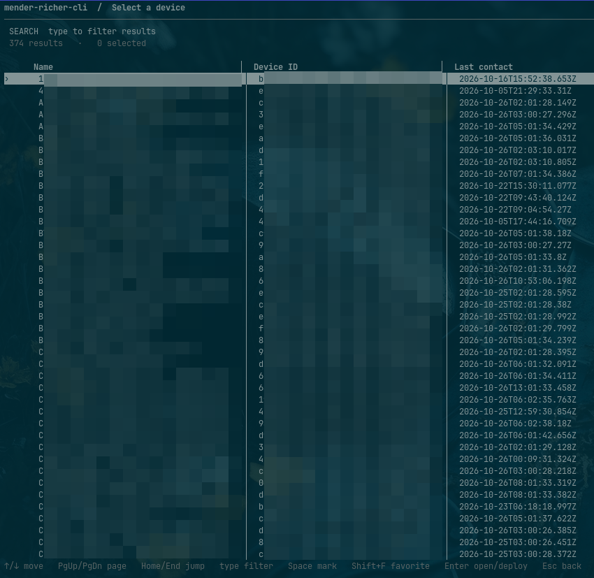

### Filtering

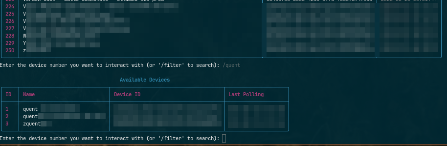

### Device commands

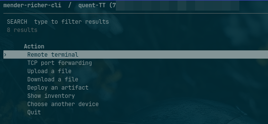

### Inventory

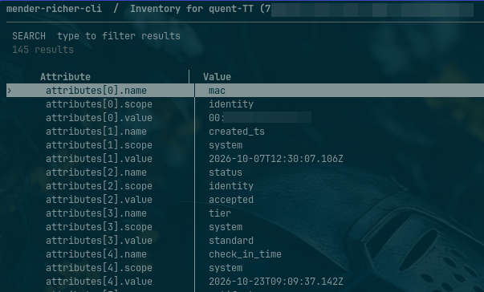

### Artifacts

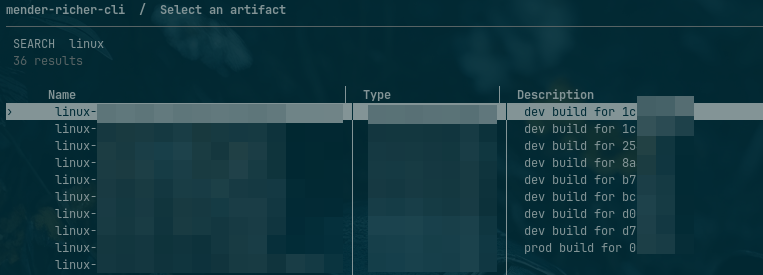

### Deployments 

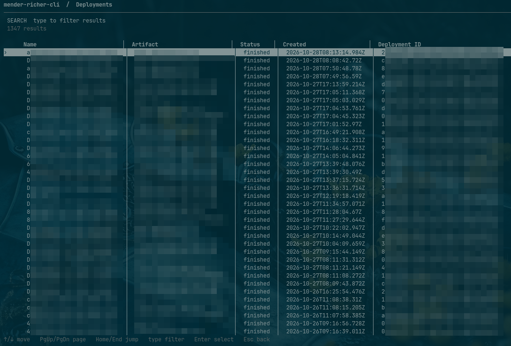

### Groups

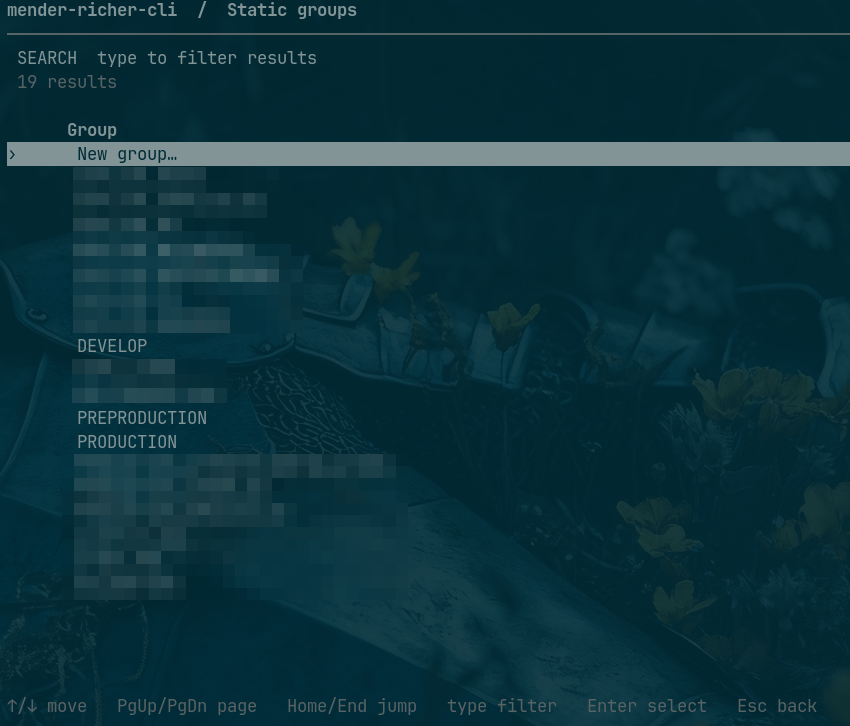

### Local web app

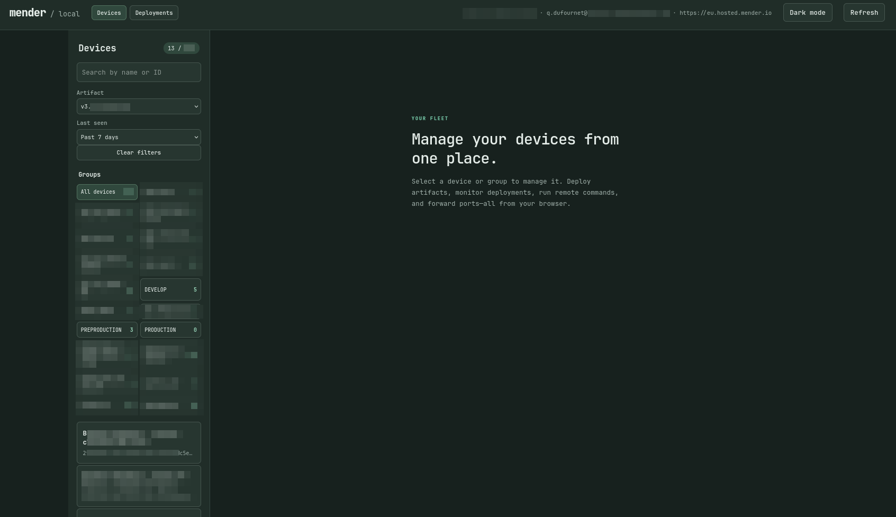

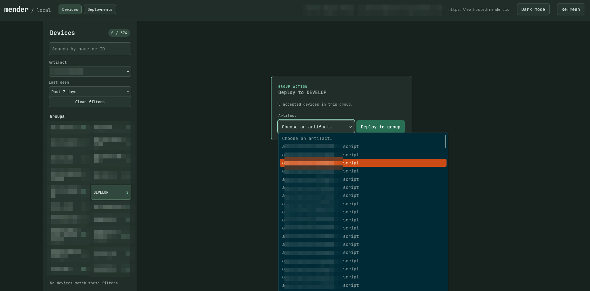

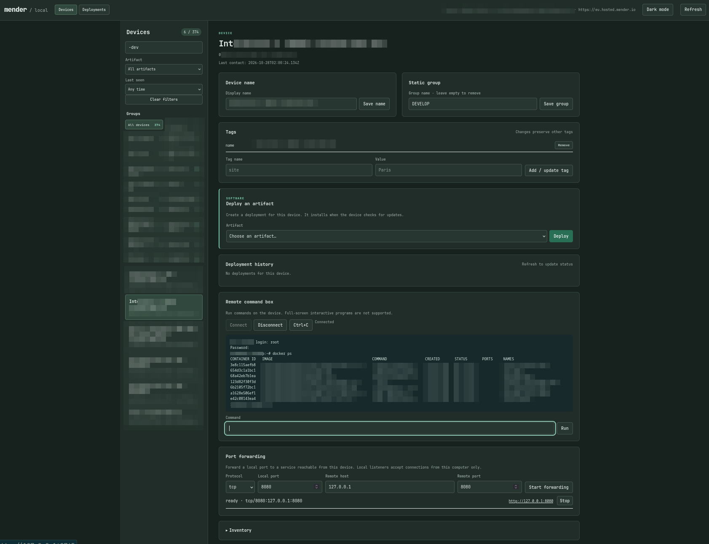

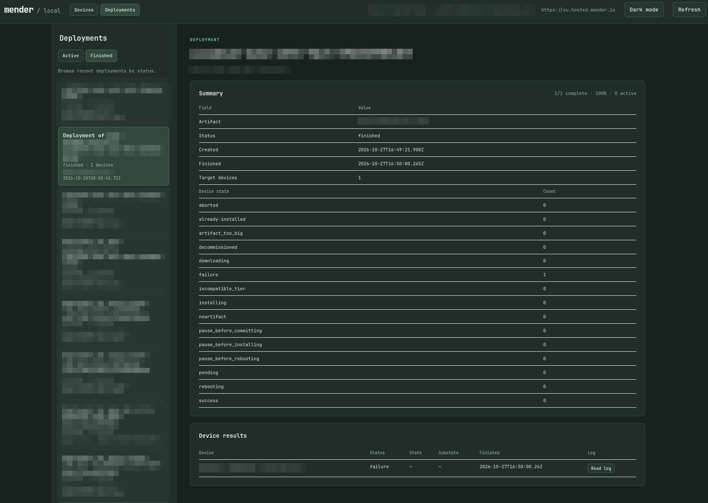

## License

Apache-2.0. See [LICENSE](LICENSE).
